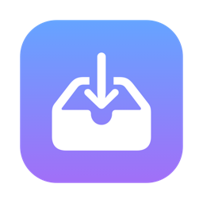

<p align="center">
  
</p>

<h1 align="center">Stash</h1>

<p align="center">
  <b>A free, fast floating drop shelf for macOS. No subscription.</b><br>
  Shake your mouse while dragging, drop anything onto the shelf, then drag it out wherever you need it.<br>
  You can even send files to and from your phone with a QR code.
</p>

<p align="center">
  
  
  
</p>

---

## Why Stash?

Moving files between windows, Spaces and apps on a Mac often means juggling two Finder windows.
Stash gives you a temporary shelf that floats above everything. Park files on it, switch to where
they need to go, and drag them out. It's a free, open-source alternative to paid shelf apps.

## Features

- **Shake to open.** Start dragging anything and shake the mouse left and right. A shelf pops up under your cursor.
- **Works with almost anything.** Files, folders, photos from the Photos app, images from Safari or Mail, text, rich text, PDFs and web links.
- **Real previews.** Photos, videos, PDFs, Office and iWork documents, and anything else Quick Look can preview.
- **Stack or grid.** Items fan out as a stack of cards. Drag the stack to move everything, or click it to browse a grid and drag single items.
- **Send to your phone.** Scan a QR code with any iPhone or Android phone on the same Wi‑Fi to download shelf items or send files back to the Mac. No app or account needed.
- **AirDrop and Share.** Send items straight from the shelf.
- **Handy actions.** Quick Look, copy, compress to ZIP, save to Downloads and show in Finder.
- **Multiple shelves.** Open as many as you like. Each one floats on every Space and over full-screen apps.
- **Native and light.** Pure Swift and AppKit, with no Electron, no tracking and no network access except the phone feature you turn on.

## Install

Stash is built from source. It takes about a minute and needs Apple's free command-line tools.

```bash
xcode-select --install          # skip if you already have them
git clone https://github.com/pgsohail/stash.git
cd stash
./build.sh --install
```

This builds `Stash.app`, copies it to `/Applications` and opens it. A tray icon appears in your
menu bar. Because the app is built on your own Mac, macOS doesn't show the "unidentified developer"
warning.

To make Stash start when you log in, click the tray icon → **Open at Login**.

## How to use

| Do this | To |
|---|---|
| Shake the mouse while dragging | Open a shelf at your cursor |
| <kbd>⌃</kbd> <kbd>⌥</kbd> <kbd>S</kbd> anywhere | Open a shelf |
| Tray icon → **New Shelf** | Open a shelf |
| Right-click a file → **Open With → Stash** | Put that file on a shelf |
| Drag the stack out | Move everything |
| Click the stack | Browse items in a grid |
| <kbd>Space</kbd> | Quick Look |
| <kbd>⌘</kbd> <kbd>C</kbd> | Copy items |
| <kbd>⌘</kbd> <kbd>A</kbd> | Select all |
| <kbd>Delete</kbd> | Remove selected items from the shelf (the files themselves stay put) |
| <kbd>Esc</kbd> | Go back, or close the shelf |

**Moving and copying.** Items you *move* somewhere, such as into another folder on the same disk,
leave the shelf. Items you *copy* somewhere, such as when uploading to a website or copying to
another disk, stay on the shelf so you can use them again.

### Phone sharing

1. Click the 📱 button on a shelf.
2. Scan the QR code with your phone's camera.
3. Tap an item to download it to your phone, or tap **Send to Mac** to upload photos and files onto the shelf.
4. Click **Stop Sharing** when you're done.

The phone and Mac must be on the same Wi‑Fi. Stash runs a small private web server only while
sharing is on. Each session gets a new random link, so only someone who scans your code can connect.
Folders download as ZIP files. The first time, macOS may ask to let Stash use the local network.

## Supported content

| Dropped content | Saved on the shelf as |
|---|---|
| Any file, folder, app or package | The original item (nothing is copied) |
| Photos from Photos, Mail attachments, Safari images | The real file, delivered by the app |
| Images from other apps | `.png` |
| Selected text | `.txt` |
| Rich text | `.rtf` |
| PDF content | `.pdf` |
| Web links | `.webloc` (double-click to open) |

New files made from snippets live in `~/Library/Caches/Stash`.

## Project layout

```
Sources/
  App.swift         Menu bar app, ⌃⌥S shortcut, shake-to-open detection
  Shelf.swift       The shelf window, its actions, keyboard and Quick Look
  Components.swift  Card stack, grid tiles, drop zone, buttons, toasts, drag-out
  Files.swift       Reading drops, snippet files, Quick Look thumbnails
  Phone.swift       Wi‑Fi phone sharing: web server, QR code, mobile page
make-icon.swift     Draws the app icon
build.sh            Builds (and optionally installs) Stash.app
```

## Requirements

- macOS 13 Ventura or later. Built and tested on Apple Silicon.
- Apple's command-line developer tools, to build it.

## License

MIT. See [LICENSE](LICENSE).
